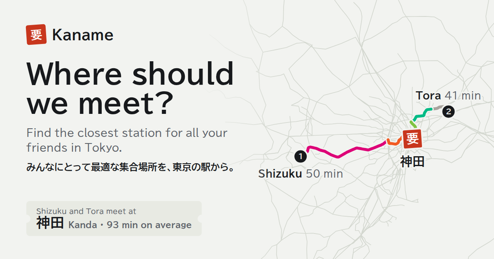

# Kaname 要

Kaname finds the best train station for a group to meet in Tokyo. Each person enters where they start and where they go home. Kaname ranks the meeting stations by the whole evening of train travel for everyone.



Try it at https://kaname-1l6.pages.dev/. The app runs in the browser on static data files. It needs no API key. Two small Cloudflare Pages Functions draw the link preview of a shared plan.

## Features

- Ranks 207 meeting stations near central Tokyo for groups of up to 50 people.
- Counts both trips for each person: from the start to the meeting station, and from there to home.
- A slider moves the ranking between the lowest average time and the lowest worst-case time.
- Draws each route on the map along the real tracks, in the line colors, and shows the last train home for each person.
- Finds a station by its Japanese or English name or by its kana reading. Finds an address on the device, so the typed text stays in the browser.
- Shares a plan as a link. The link holds stations, names and settings, never a location or an address.
- Shows the plan in the link preview: who meets where, the numbers, and each person's trains on a map. A friend sees the answer without opening the app.
- English and Japanese, light and dark mode, phone and desktop layouts.

## Demo

Three friends meet after work on a weekday. Aki works in 大宮 and lives in 柏. Ben and Chie work in 新宿, and they live in 川崎 and 渋谷. Each link opens the group in the app with the slider at that position.

| Slider | Station | Average trip | Longest trip | Changes |
| --- | --- | --- | --- | --- |
| [Efficient](https://kaname-1l6.pages.dev/?p=omiya.kashiwa_Aki&p=shinjuku.kawasaki_Ben&p=shinjuku.shibuya_Chie&fair=0) | 新宿 | 40 min | 84 min (Aki) | 2 |
| [Middle, the default](https://kaname-1l6.pages.dev/?p=omiya.kashiwa_Aki&p=shinjuku.kawasaki_Ben&p=shinjuku.shibuya_Chie) | 東京 | 45 min | 70 min (Aki) | 1 |
| [Fair](https://kaname-1l6.pages.dev/?p=omiya.kashiwa_Aki&p=shinjuku.kawasaki_Ben&p=shinjuku.shibuya_Chie&fair=100) | 日暮里 | 55 min | 59 min (Aki) | 2 |

The efficient end picks the station where Ben and Chie already are, so Aki rides 84 minutes. The default picks 東京, which cuts Aki's trip to 70 minutes and keeps the others near half an hour. The fair end gives everyone 50 to 59 minutes.

The command line ranks the same group:

```bash
npm --prefix web run cli -- --person "Aki:大宮>柏" --person "Ben:新宿>川崎" --person "Chie:新宿>渋谷"
```

## Quick start

You need Node.js 22.12 or later. The generated data is in the repo, so you do not need the data pipeline to run the app.

```bash
npm --prefix web install
npm --prefix web run dev        # http://localhost:5173/
```

To load the app without map tiles, add `?basemap=none` to the URL.

## How it works

Kaname has three parts:

1. A Python pipeline (`pipeline/`) reads a public weekday timetable. It calculates travel minutes, transfers, last trains and routes between all 1,419 stations and the 207 candidates. It writes them to `data/` as compact binary arrays.
2. A scoring engine (`web/core/`) ranks the candidates. It is plain TypeScript with no runtime dependencies and no DOM.
3. A web app (`web/src/`) shows the ranking, the routes and the map. It uses React and MapLibre GL.

For each person $`i`$ and candidate station $`X`$, the engine adds up the cost of the evening. Then it scores the group:

```math
\begin{aligned}
c_i(X) &= t(s_i \to X) + t(X \to h_i) + \lambda \cdot \mathrm{transfers}_i(X) + \mathrm{walk}_i(X) \\
J(X) &= \alpha \cdot \frac{1}{n} \sum_{i=1}^{n} c_i(X) + (1 - \alpha) \cdot \max_{i} c_i(X)
\end{aligned}
```

Here $`s_i`$ is the start of person $`i`$ and $`h_i`$ is their home. $`n`$ is the size of the group. The station with the lowest $`J`$ ranks first. The slider sets $`\alpha`$, and $`\lambda`$ is 10 minutes for each transfer. The app shows plain trip minutes, so the penalty only orders the stations. A ranking for 20 people takes less than 1 ms, because each value is a lookup in a typed array.

- A map location snaps to its 3 nearest stations, at most 2 km away. Each trip uses the cheapest of the 3.
- Ties go to the station with more lines, then to the lower spread between people, then to the station id.
- The result also holds the Pareto set of average and worst-case times, for a view of the tradeoff.

`docs/data-format.md` describes the data files, the route encoding and what the travel times include. `docs/tuning.md` shows how the default α and λ were tested on 1,000 sampled groups.

## Repository layout

| Path | Contents |
| --- | --- |
| `web/src/` | The web app |
| `web/core/` | The scoring engine |
| `web/preview/` | The link preview of a shared plan: its text and its picture |
| `web/functions/` | The Cloudflare Pages Functions that serve the preview |
| `web/tests/` | Unit tests for the engine and the app (Vitest) |
| `web/e2e/` | End-to-end tests on a phone and a desktop viewport (Playwright) |
| `cli/` | The command line front end for the engine |
| `pipeline/` | The Python pipeline that builds the data (managed with uv) |
| `pipeline/config/` | Build parameters and reviewed correction tables |
| `pipeline/validation/` | Reference journey times for the accuracy test |
| `data/` | The generated data, `meta.json` and `LICENSES.md` |
| `docs/` | The data format, the tuning study and internal notes |

## Tests

```bash
npm --prefix web test               # unit tests
npm --prefix web run coverage       # unit tests with coverage
npm --prefix web run typecheck      # TypeScript
npm --prefix web run e2e            # end-to-end tests
cd pipeline && uv run pytest --cov  # pipeline tests
```

Before the first end-to-end run, install the browser with `npx --prefix web playwright install chromium`.

## Command line

The command line ranks stations with the same engine. A person is `label:start>home`. A place is a station id, a Japanese or English station name, or `lat,lng`. Without `>home`, the person goes home to the start.

```bash
npm --prefix web run cli -- --person "Aki:町田" --person "Ben:大宮>船橋" --person "Chie:35.6905,139.7003>千葉"
```

`--alpha` sets the balance: 1 is the lowest average, 0 is the lowest worst case, and the default is 0.5. Other options are `--lambda` (minutes for each transfer, default 10), `--end` (a meeting end time), `--top` and `--json`. Run it with `--help` for the full list.

## Rebuild the data

You need `git`, `bash` and [uv](https://docs.astral.sh/uv/) for this part. uv also installs Python 3.11 or later for you.

1. Fetch the timetable source at the pinned commit. This downloads about 110 MB into `.cache/mt3d`, which git ignores.
   ```bash
   bash pipeline/fetch_mt3d.sh
   ```
2. Build the data files into `data/`. This takes about 30 seconds on 32 cores.
   ```bash
   cd pipeline && uv run kaname-pipeline build
   ```
3. Test the written files for consistency.
   ```bash
   uv run kaname-pipeline check
   ```
4. Compare the travel times with the reference journey times. If fewer than 90% of the pairs are within 5 minutes, the command fails.
   ```bash
   uv run kaname-pipeline validate
   ```
5. Fetch the search data (kana readings and address points, about 3 MB), then write `kana.json` and `addresses.json`.
   ```bash
   uv run kaname-pipeline fetch-lookup
   uv run kaname-pipeline lookup
   ```
6. Fetch the railway sections (about 15 MB), then write the track shapes to `shapes.json`. The download must match a pinned checksum.
   ```bash
   uv run kaname-pipeline fetch-shapes
   uv run kaname-pipeline shapes
   ```

## Plan links

The address bar always holds a link to the current plan, and "Share plan" shares it.

```text
https://kaname-1l6.pages.dev/?p=seiseki-sakuragaoka_Shizuku&p=shibamata_Tora&fair=75&at=jimbocho
```

- `p`: one for each person. It holds the start station id, then `.` and the home station id, then `_` and the name. The home part is only there for a person whose home is not the start. A location or an address goes as the station that it snapped to.
- `fair`: the slider, from 0 (lowest average) to 100 (lowest worst case). The link leaves out the default, 50.
- `at`: the station picked from the ranking.

## Deploy

`npm --prefix web run build` writes a static site to `web/dist/`. Any static host can serve it. The build also writes packed copies of the data in `packed/`: a gzip copy of each matrix and one small file per station's routes. The app uses them, so a first visit loads about 1.6 MB. Without them, it loads the data files as they are.

Link previews need the full URL of the preview image. Set `KANAME_SITE_URL` to your site before the build, for example `KANAME_SITE_URL=https://example.org npm --prefix web run build`.

`npm --prefix web run og` renders the preview image and the icons in `web/static/` from the real data. Run it again after a design change.

### Plan previews

A link with a plan gets its own link preview from two Cloudflare Pages Functions in `web/functions/`. Preview bots read the page without running the app, so the functions rank the stations on the server with the same engine and data.

- `/` with a `p` parameter: the function rewrites the preview tags of the page, for example "Shizuku and Tora meet at 神田 (Kanda)".
- `/og/plan`: the function draws the plan's picture, 1200 by 630, with resvg and the BIZ UDPGothic fonts in `web/static/`. Cloudflare's cache keeps each picture for a day.

Drawing a picture takes more processing time than the Workers Free plan gives (10 ms for each request), so the account needs Workers Paid. If a function fails, the page and the general picture are served instead. A host without functions serves the site with the general preview for every link.

To see a plan's picture without a deploy, draw it from the local data:

```bash
npm --prefix web run plan-card -- "?p=shibamata_Tora&p=kunitachi_Kai" card.png
```

To run the site with its functions, build it, then run `npx wrangler@4.153.0 pages dev dist` in `web/`.

## Limits

- The times are estimates from one weekday timetable and a simple transfer model. They do not include delays or timetable changes. Before you rely on a last train, look it up in an official source.
- On two sets of test pairs that the model never saw, 48 of 50 trips are within 5 minutes of a commercial journey planner. Changes at deep underground platforms come out about 1 minute short on average.
- Stations more than 60 km from Tokyo Station have no data.
- 26 of the 1,419 stations have no kana reading. Search still finds them by name.

## Data sources

The timetables come from [Mini Tokyo 3D](https://github.com/nagix/mini-tokyo-3d) (MIT). The kana readings come from Wikidata (CC0). The track shapes, the platform positions and the address points come from MLIT 国土数値情報 and 位置参照情報. The repo holds only derived data, never raw timetables. `data/LICENSES.md` gives the terms and credits for each source. The preview pictures use the BIZ UDPGothic fonts (SIL Open Font License 1.1, `web/static/BIZUDPGothic-OFL.txt`).
